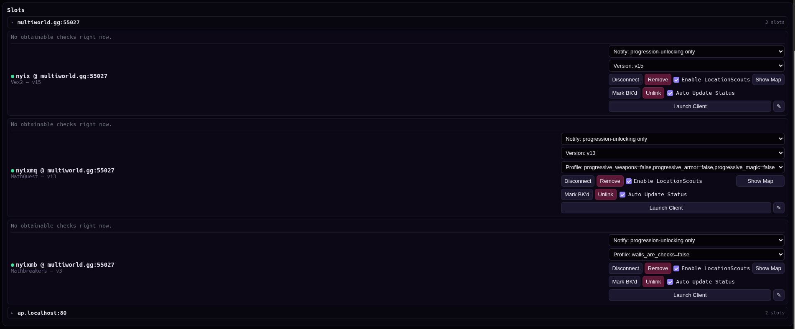
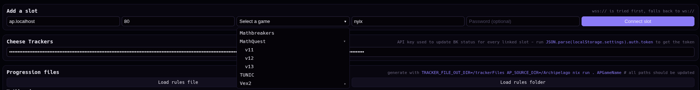
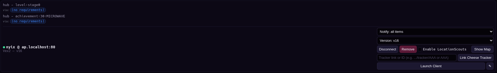
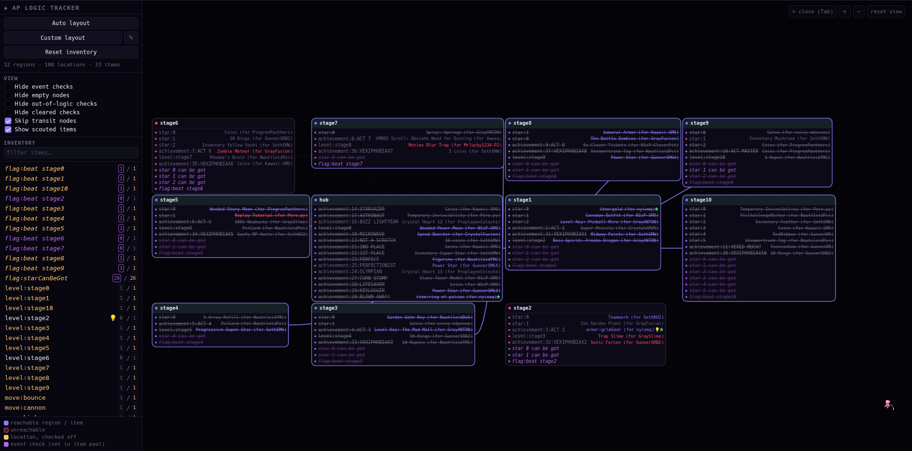
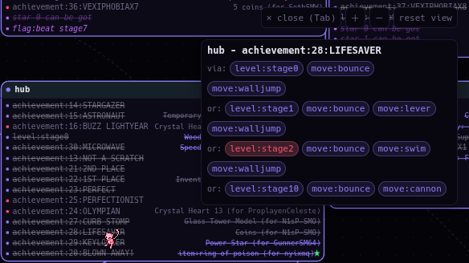
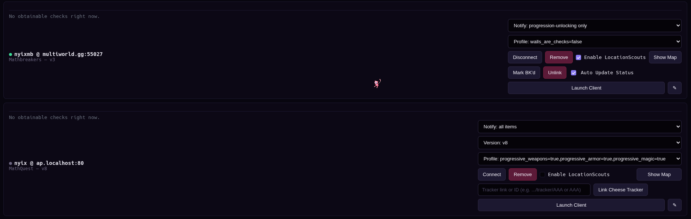
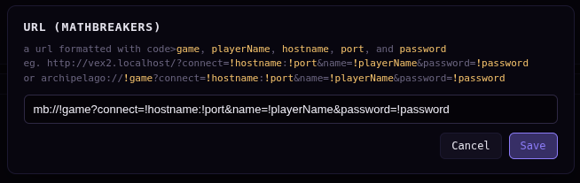

# AP Multi-Slot Tracker

A browser-based tracker for [Archipelago](https://github.com/ArchipelagoMW/Archipelago/) that connects to **multiple slots at once**, gives you desktop notifications when items unlock new checks, and renders a full logic-aware map for each connected game — all client-side, no server required.
The main goal of this project is to make tracking logic work for every game without requiring world devs having to support any trackers - everything can be done solely by the users of this tracker.

## Features

### Multi-slot connection manager

- Connect to as many Archipelago slots (rooms/players) simultaneously as you want, each tracked independently.
- Per-slot connection status (connecting / connected / error / disconnected) with automatic `wss://` → `ws://` fallback.
- Previously connected slots auto-reconnect on page load.
- Per-slot notification modes: **none**, **all items**, **progression-unlocking only**, or **all (with progression highlighted)**.
- Desktop notifications via the Notifications API when items come in, optionally only when they actually unlock something new.

### Logic-aware progression tracking

- Rules are generated from a live copy of the world in the set ap folder.
- Per-slot log of currently **obtainable-but-unchecked** locations, each annotated with the exact item requirements (as OR-of-AND requirement chips) that make the check reachable in logic.
- Supports multiple versions of the same world to be switched separately per slot
- Supports rules files with **multiple bundled settings profiles** for worlds where some options can change the rules generated

### Interactive logic map

- A full pan/zoom canvas map of the loaded game's regions, entrances, and locations, opened per-slot with **Show Map** (or the `Tab` key to toggle last opened slots map).
- Nodes are colored by reachability; locations show checked/unchecked, event, hinted, and scouted-item state.
- Drag nodes to reposition them (saved per game), or use:
  - **Auto layout** — automatic BFS-layer based layout.
  - **Custom layout** — write your own `sort(name) -> {x, y}` grid-placement function per game, saved and editable in-app.
- View filters: hide event checks, hide empty nodes, hide out-of-logic checks, hide cleared checks, skip transit (check-less) nodes, show scouted items (only shows if items for the active slot have also got location scouts enabled).
- Hovering a location shows a popup with its requirement groups, color-coded by what you currently own and what is currently missing for each unique method of obtaining the check.
- Search box (`/` to focus) filters both the inventory list and the map to matching items/regions/locations.
  - `esc` to clear active search `enter` to defocus without clearing search text
- Right-click menu for invenory items
  - button to request an in-game hint for the item - can press multiple times to rehint if more than one of the item exist.
- Item Indicators - need better name i think
  - a 💡 is shown on inventory items that the slot has hinted
  - a 💡 is shown on the map on locations that have a hinted item located there
  - a green ★ is shown on local items
  - a yellow ★ is shown on nonlocal items that are for another tracked slot

### Cheese Trackers integration

- Link any slot to a game on a [Cheese Trackers](https://cheesetrackers.theincrediblewheelofchee.se/) tracker by just entering the tracker id/url.
- Manually toggle or **auto-sync** a slot's BK (blocked) status to match whether it currently has any obtainable checks.

### Launch URL shortcuts

- Define a per-game "Launch Client" URL template (e.g. to jump straight into a game's own web client or `archipelago://` handler) with placeholders for `!hostname`, `!port`, `!playerName`, `!password`, `!game`.
- One click from a slot card opens the game's client pre-filled with that slot's connection info.

### Import / export

Buttons next to **Load rules folder** let you back up and restore the tracker's state. Each one opens a directory picker.

- **Export (partial)** — writes just `./db.json` (slots, settings, layouts, views, etc.; file system handles can't be serialized so they are left out).
- **Export (full)** — writes `./db.json` plus:
  - `./trackedFolder/*.json` — the contents of the loaded rules folder
  - `./trackedFiles/*.json` — individually loaded rules files (files already in the rules folder aren't duplicated)
- **Import (partial)** — reads `./db.json` only and ignores everything else.
- **Import (full)** — reads `./db.json`, then loads `trackedFiles` and `trackedFolder` exactly as if they were loaded via **Load rules file** / **Load rules folder** (the imported folder becomes the tracked rules folder).
- **Auto-export on load** checkbox — when enabled, every page load re-saves to the same folder, using the same mode (full/partial), as the most recent export. Do one manual export first to choose the folder; the browser may ask you to re-grant write access.

### Offline-friendly

- Installable as a PWA with a service worker that caches the app shell and serves cached responses when the network is unavailable.

## Usage

### 1. Add a slot

Fill in the **Add a slot** form: server hostname, port, the game (selected from rules files you've loaded — games with multiple loaded versions expand into a submenu), your slot name, and an optional password. Submitting connects immediately and saves the slot.

### 2. Track it

- Watch the slot card's log for newly obtainable checks and desktop notifications as items arrive.
- Click **Show Map** to open the full logic map for that slot; it stays synced live as items/checks come in.
- Optionally link the slot to **Cheese Trackers** and set up a **Launch Client** URL for it.

## Architecture notes

- js webapp and python backend.
- The map is rendered on a single `<canvas>` rather than per-node DOM elements, so it stays fast even with very large logic graphs — only on-screen nodes/edges are drawn each frame.
- `RuleEngine.evalRule` (the logic-tree evaluator) and `MapEngine`'s reachability pass are shared between the live map UI and the headless progression tracking used for notifications/Cheese Trackers sync, so both always agree on what's currently reachable.

## Requirements

- A modern browser with WebSocket support.
- An Archipelago server to connect to.
- Python 3.14 an Archipelago source checkout with the world to track installed in it.
